# Sandbox
> Testing different kind of things - technologies - libs.
> Don't try this at home !

Online live code is here: [https://dorianbayart.github.io/sandbox](https://dorianbayart.github.io/sandbox)  
Source code is here: [https://github.com/dorianbayart/sandbox](https://github.com/dorianbayart/sandbox)

## Games
### Pathfinding
[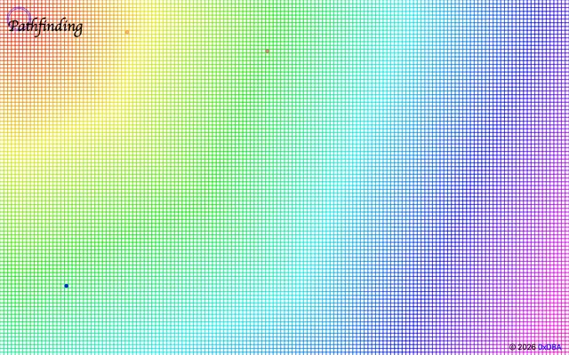](games/pathfinding)

Pathfinding algorithm: [Pathfinding](games/pathfinding)

### Pixel Fortress
[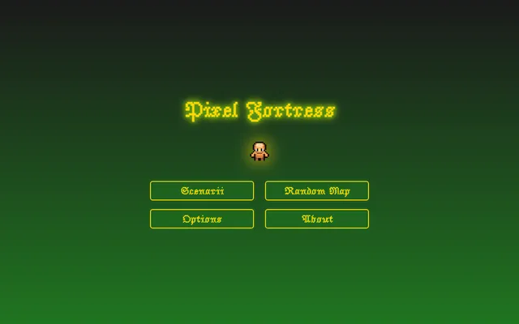](games/pixel-fortress)

A pixelated game in-between Tower Defense and Clicker styles: [Pixel Fortress](games/pixel-fortress)

### Minimalist Tower War
[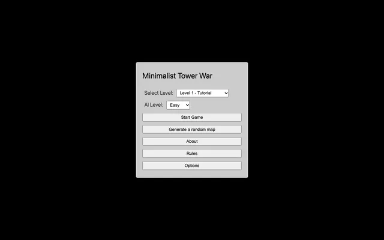](games/tower-war)

A minimalist tower war style game: [Minimalist Tower War](games/tower-war)

### Neural Race
[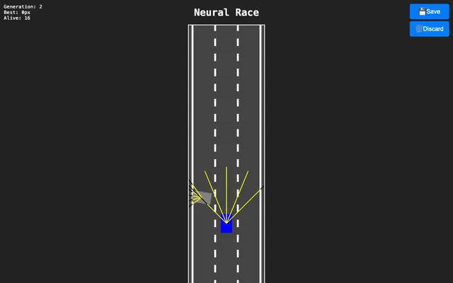](games/road/03)

Race against self-driving cars whose neural networks learn to dodge traffic, generation after generation: [Neural Race](games/road/03)

### Unlimited RPG Clicker
[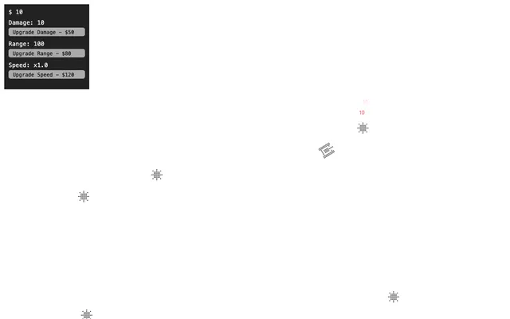](games/unlimited-rpg-clicker)

Click the enemies and upgrade damage, range and speed, built with PixiJS: [Unlimited RPG Clicker](games/unlimited-rpg-clicker)

### Idle Empires
A multiplayer incremental idle game: grow your empire, trade and fight other players. Node.js server, work in progress: [Idle Empires](games/idle-empires/README.md)

## Tools
### Image to PixelArt SVG
[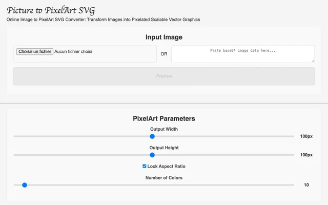](utils/pixelart-converter)

An image to pixel art SVG converter: [Image to PixelArt SVG](utils/pixelart-converter)

### Image to SVG
[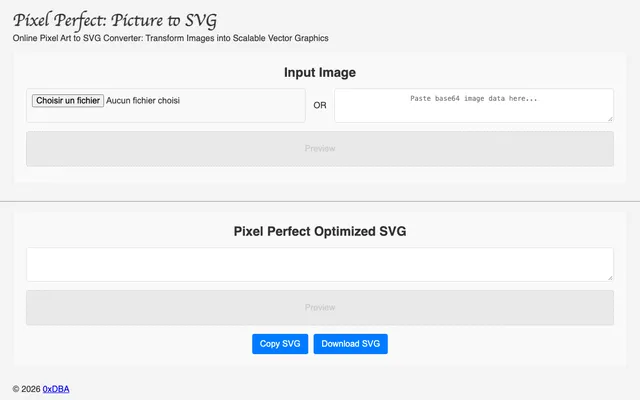](utils/pixel-perfect-converter)

An image to pixel perfect SVG converter: [Image to SVG](utils/pixel-perfect-converter)

### QR Code
[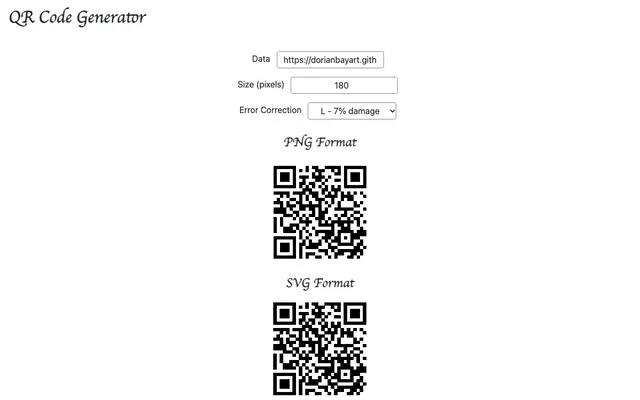](utils/qr)

Generate a QR code: [Qr](utils/qr)

### Emoji flags
[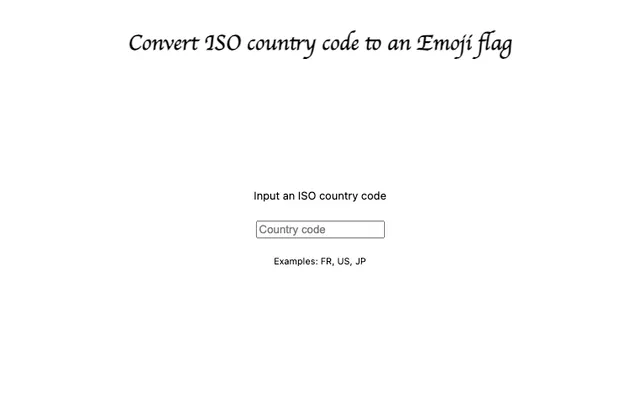](utils/emoji-flags)

A tools to convert country codes into their emoji flag: [Emoji Flags](utils/emoji-flags)

### SVG Repo
[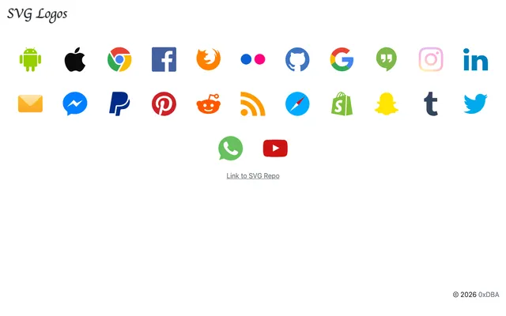](utils/svg-icons)

Fetch a JSON file and display few SVG images: [SVG Icons](utils/svg-icons)

### Webcam
[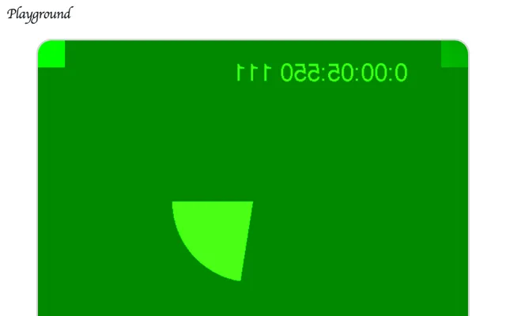](utils/webcam)

Display a canvas with the webcam stream: [Webcam](utils/webcam)

## Experiments
### Neural Driving Blobs
[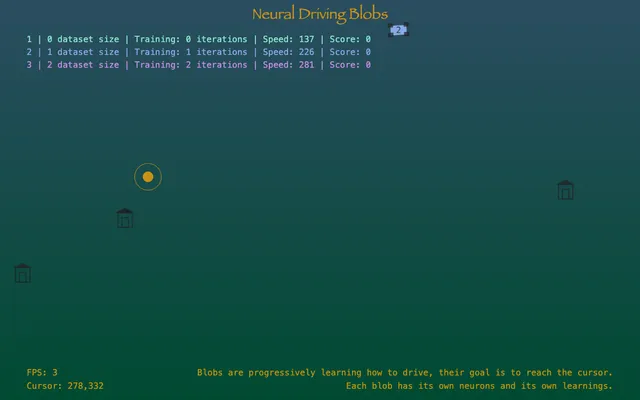](neural-network)

Blobs, each with its own neural network, progressively learn to drive towards the cursor: [Neural Driving Blobs](neural-network)

### Glow/backlight effect
[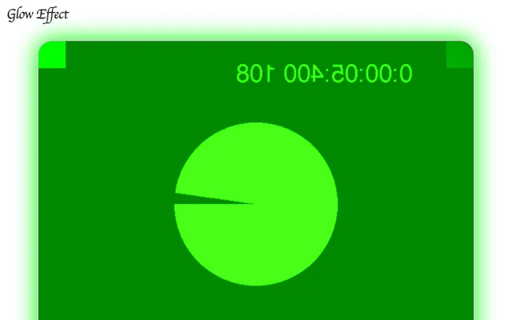](glow-effect)

Display a dynamic glow effect depending on the webcam content: [Glow Effect](glow-effect)

### Canvas
[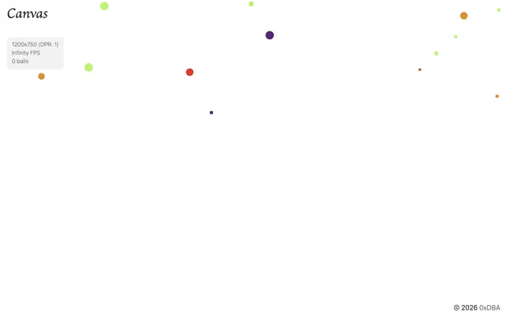](canvas)

Playing with canvas: mouse, responsive fullscreen, colors, simulated gravity: [Canvas](canvas)

### PeerToPeer
[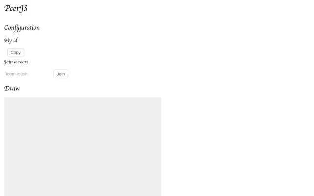](peerjs)

Testing the PeerJS library (WebRTC): [PeerJS](peerjs)

### Workers
[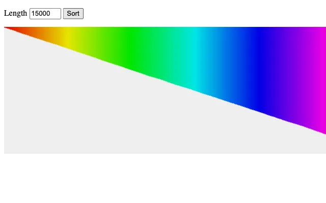](workers)

Use Web Workers to bubble sort a very big array: [Workers](workers)

### Mathematics - Algorithms
[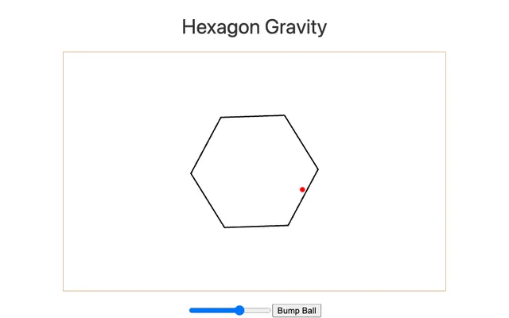](mathematics/hexagon-gravity.html)

Fibonacci algorithms - Memoization, Map, BigInteger: [fibonacci.js](mathematics/fibonacci.js)

A ball bouncing with gravity inside a rotating hexagon: [Hexagon Gravity](mathematics/hexagon-gravity.html)

## Boilerplates
### Games boilerplate

A boilerplate project to start coding on fullscreen canvas: [Boilerplate](games/boilerplate)

### Alpine
[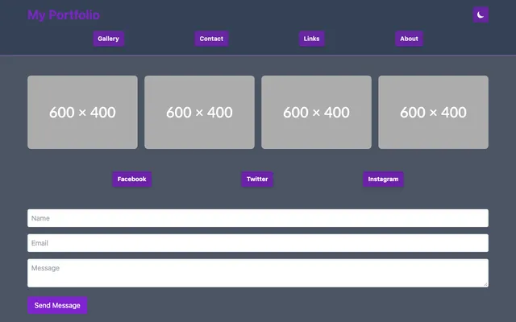](alpinejs)

Boilerplate with AlpineJS and TailwindCss: [AlpineJS](alpinejs)

### Link-in-Bio
[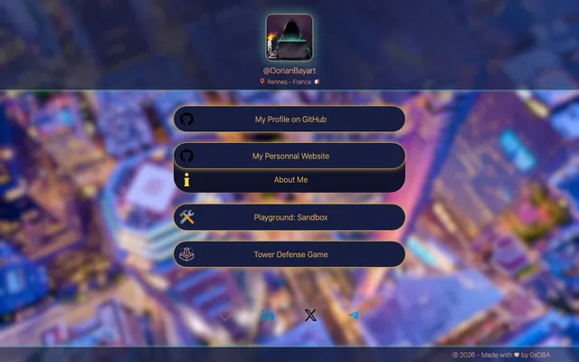](link-in-bio)

Link-in-Bio boilerplate: [Link-in-Bio](link-in-bio)

### Loader
[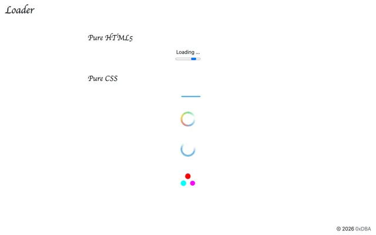](utils/loader)

Mini loader exemples: [Loader](utils/loader)
